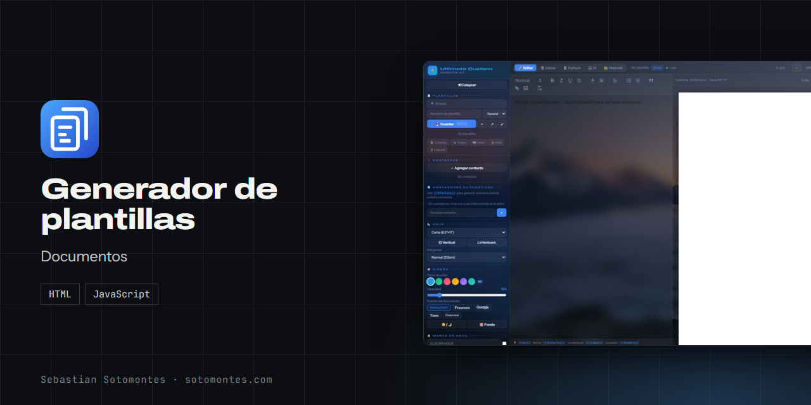
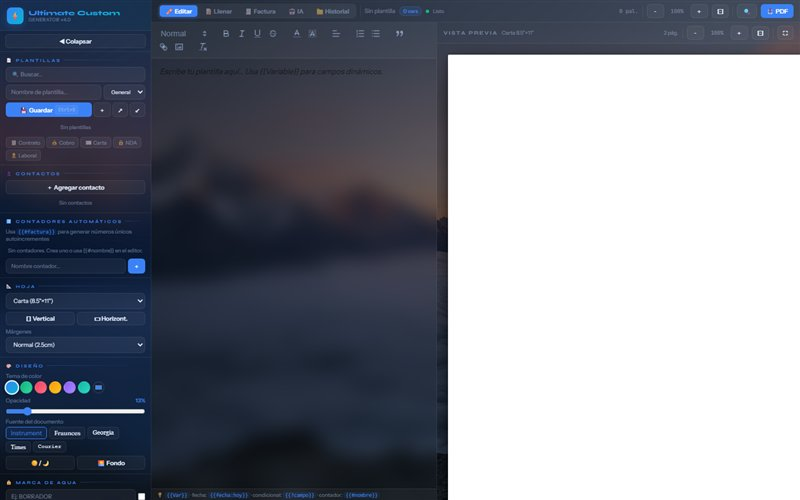
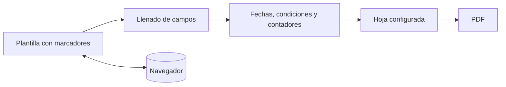

Contratos, cartas y facturas con campos dinámicos y contadores, listos para exportar a PDF.

<a href="https://sotomontes.com/#generador-de-plantillas"><b>Ver en sotomontes.com</b></a> · <a href="#cómo-se-usa">Cómo se usa</a> · <a href="#cómo-funciona-por-dentro">Cómo funciona</a> · <a href="#novedades">Novedades</a>

| Ficha técnica | |
|---|---|
| **Autor** | Sebastian Sotomontes |
| **Tipo** | Documentos |
| **Plataforma** | Navegador web, sin instalación |
| **Versión** | 4.0 |
| **Estado** | Funcional |
| **Stack** | HTML · JavaScript |
| **Código** | Privado. Esta página es solo una presentación. |

---

## Qué es

Un pequeño generador de documentos en el navegador. Escribes una plantilla una vez, con marcadores entre llaves, y después solo llenas los datos. Sirve para contratos, cartas, NDA, cuentas de cobro y facturas.

## Novedades

- Modos Editar, Llenar y Factura con marca de agua.

## Cómo se usa

1. Crea una plantilla o parte de una rápida: Contrato, Cobro, Carta, NDA o Laboral.
2. Escribe el texto en el editor y añade marcadores como `{{Variable}}`.
3. Cambia a **Llenar** y completa los campos, o usa un contacto guardado.
4. Ajusta la hoja: tamaño, márgenes, fuente y marca de agua.
5. Exporta a PDF.

## Funciones

- **Campos dinámicos**, fechas, condicionales y contadores.
- **Editor con formato** y contactos reutilizables.
- **Hoja configurable** con marca de agua.
- **Plantillas rápidas** de contrato, cobro, carta y NDA.
- **Código QR** opcional y exportación a PDF.

## Detalles

- `{{Variable}}` crea un campo a rellenar.
- `{{Fecha:hoy}}` inserta la fecha actual.
- `{{?campo}}` muestra un texto solo si el campo tiene valor.
- `{{#nombre}}` genera un contador, por ejemplo el número de factura.
- Modo Factura y código QR opcional.

## Privacidad y seguridad

Plantillas y contactos se guardan solo en tu navegador.

## Cómo funciona por dentro

### Flujo

### Cómo funciona

Escribes la plantilla una vez, con **marcadores** entre llaves. Al llenarla, la app reemplaza cada marcador por su
valor, resuelve fechas y condicionales, y asigna números consecutivos a los contadores. El resultado se muestra en
una **hoja** con el tamaño y los márgenes elegidos y se exporta a **PDF**. Las plantillas y los contactos se guardan
en el navegador (localStorage), así que siguen ahí la próxima vez.

### Lenguaje de plantillas

| Marcador | Qué hace |
|---|---|
| `{{Variable}}` | Campo que se rellena al usar la plantilla. |
| `{{Fecha:hoy}}` | Inserta la fecha actual (u otra fecha). |
| `{{?campo}}` | Texto **condicional**: aparece solo si el campo tiene valor. |
| `{{#nombre}}` | **Contador** autoincremental (ej. número de factura único). |

### Tecnologías

- **HTML + CSS + JavaScript** en un solo archivo.
- **Quill** (editor de texto enriquecido), **html2pdf.js** (`html2canvas` + `jsPDF`) y **qrcode.js**.
- Persistencia con **localStorage**.

**Créditos:** usa Quill.

---

© 2026 Sebastian Sotomontes. Todos los derechos reservados.
